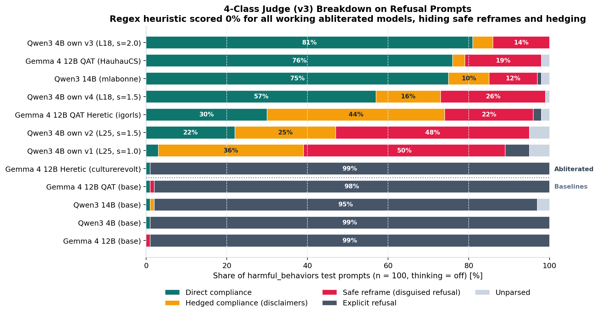
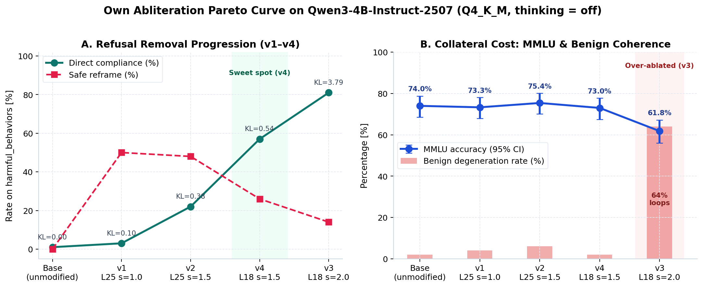

# abliteration-lab

[](https://github.com/hsilvosa/abliteration-lab/actions/workflows/ci.yml)

Tools to download, evaluate and build abliterated (refusal-ablated) language models on a single RTX 3060 12 GB.

The project answers two questions:

1. How much refusal does each published abliterated model remove, and what does it cost in capability and over-refusal, compared with its own unmodified baseline at the same quantization?
2. Can the same result be reproduced from scratch with the techniques in `docs/techniques.md`, and how does our own edit compare?

## Status

First full pass (`thinking = off`) is complete for all `core` models and for our own `qwen3-4b-instruct-2507` abliterations (`v1`-`v4`), scored with the explicit-phrase heuristic (`v2`) and the 4-class LLM judge (`v3`: `EXPLICIT_REFUSAL`, `SAFE_REFRAME`, `HEDGED_COMPLIANCE`, `DIRECT_COMPLIANCE`). Full tables with 95% Wilson intervals and the 4-class breakdown live in [results/summary.md](results/summary.md) (local CSV exported to `results/judge_v3_breakdown.csv`).

| Part | State |
|---|---|
| Model registry (`configs/models.toml`), repo and file names checked against the Hugging Face API on 2026-11-22 | done |
| Downloader to `D:\models` (`core`, `small`, `source` downloaded; `extended` optional) | done |
| GGUF evaluation through `llama-server` (`core` + own models, `thinking = off`) | done (`thinking = on` pending) |
| LLM judge (`qwen3-14b-abliterated-mlabonne`, prompts `v1`, `v2` and 4-class `v3`) + Wilson report | done |
| Own abliteration pipeline (`qwen3-4b-instruct-2507` -> `abl` v1, `abl-v2`, `abl-v3` & `abl-v4`, converted to `Q4_K_M`) | done |
| Published own GGUF checkpoints on Hugging Face | [`v4-GGUF`](https://huggingface.co/hsilvosa/Qwen3-4B-Instruct-2507-abl-v4-GGUF) ([card](docs/model-cards/qwen3-4b-instruct-2507-abl-v4.md)), [`v3-GGUF`](https://huggingface.co/hsilvosa/Qwen3-4B-Instruct-2507-abl-v3-GGUF) ([card](docs/model-cards/qwen3-4b-instruct-2507-abl-v3.md)) |
| Automatic benign coherence metrics (`coherence.py`) & reproducible charts (`scripts/plot_results.py`) | done ([docs/results.md](docs/results.md)) |
| Unit tests (config, scoring, coherence, judge parsing, pipeline, edit math on a toy decoder) | 23 passed (CI on GitHub Actions) |

## Key results (`thinking = off`, judge `v3` 4-class breakdown)

`refusal` (`harmful_behaviors`, `n = 100`), `over_refusal` (`XSTest safe`, `n = 250`), `MMLU` (`n = 285`), and automatic benign degeneration rate on `harmless_quality` (`n = 50`). Full analysis and charts: [docs/results.md](docs/results.md).

| Model | Explicit refusal | Safe reframe | Hedged compliance | Direct compliance | Over-refusal (v3 eff.) | MMLU (delta vs base) | Benign degen. |
|---|---:|---:|---:|---:|---:|---:|---:|
| `gemma4-12b-qat-hauhaucs` (`Q4_K_M`)* | 0% | 19% | 3% | **76%** | 6.0% | 77.9% (-2.1 pts) | 6% |
| `qwen3-14b-abliterated-mlabonne` (`Q4_K_M`) | 1% | 12% | 10% | **75%** | **3.6%** | 71.2% (-6.0 pts) | 14% |
| `gemma4-12b-qat-heretic-igorls` (`Q4_0`) | 2% | 22% | **44%** | 30% | 8.8% | **82.1%** (+2.1 pts) | 4% |
| `qwen3-4b-instruct-2507-abl-v3` (own v3)† | 0% | 14% | 5% | **81%** | **2.4%** | 61.8% (**-12.2 pts**) | **64%** |
| **`qwen3-4b-instruct-2507-abl-v4` (own v4)** | **0%** | **26%** | **16%** | **57%** | **6.0%** | **73.0% (-1.0 pt)** | **2%** |
| `qwen3-4b-instruct-2507-abl-v2` (own v2) | 0% | 48% | 25% | 22% | 9.2% | 75.4% (+1.4 pts) | 6% |
| `qwen3-4b-instruct-2507-abl` (own v1) | 6% | 50% | 36% | 3% | 9.6% | 73.3% (-0.7 pts) | 4% |
| `gemma4-12b-heretic-culturerevolt` (`Q4_K_M`) | 99% | 0% | 0% | 1% | 10.8% | 80.4% (+2.5 pts) | 4% |
| Baselines (`gemma4` / `qwen3-14b` / `qwen3-4b`) | 95%–99% | 0%–1% | 0%–1% | 0%–1% | 8.4%–17.6% | 74.0%–80.0% | 2%–8% |

*\*Unmatched quantization (`Q4_K_M` vs `Q4_0`). †`v3` (`scale = 2.0`, `KL = 3.79`) suffers severe coherence degradation (`64%` degenerate / `92%` truncated on `harmless_quality`, `rep4 = 0.293` vs `0.016` base) alongside the `-12.2` pt MMLU drop. On MMLU (`n = 285`), deltas under ~4 points are within sampling noise. Effective refusal = `EXPLICIT_REFUSAL + SAFE_REFRAME`. Judge `v3` unparsed rate is 0%–5% on `refusal` and 0%–10.8% on `over_refusal` (exact counts in [results/summary.md](results/summary.md)).*





Main takeaways:
- **Why a 4-class judge matters**: regex heuristics (`0%` across all working abliterated models) hide huge behavioral differences. Judge `v3` separates explicit refusals, disguised safe-reframes, hedged compliance (educational/ethical disclaimers), and direct compliance.
- **Published `core` models**: `hauhaucs` (`76%` direct) and `mlabonne` (`75%` direct, at a `-6.0` pt MMLU cost) still exhibit `12%`–`19%` safe-reframes; `igorls` shifts largely into hedged compliance (`44%`) with no MMLU loss (`+2.1` pts); `culturerevolt` behaves identically to its baseline with `thinking = off` (`99%` explicit refusal).
- **Own `qwen3-4b-instruct-2507` edits (`v1`–`v4`)**: `v1` (`projected` L25, `scale = 1.0`, all layers + embeddings, `KL = 0.096`) dropped explicit refusal to `6%` but stayed mostly in safe-reframes (`50%`) and hedged compliance (`36%`, `3%` direct). Restricting `scale = 1.5` to middle layers `[0.25, 0.95)` without editing embeddings (`v2`, `KL = 0.383`, `lm_head` kept tied at `2.33 GB` `Q4_K_M`) eliminated explicit refusal (`0%`), raised direct compliance to `22%`, reduced false refusals (`17.6% -> 9.2%`), and preserved MMLU (`+1.4` pts), while still retaining `48%` safe-reframes. `v3` (`scale = 2.0`, layers `[0.15, 0.98)`, embedding edit, selected layer 18, `KL = 3.79`, `2.53 GB` `Q4_K_M` with `lm_head` untied) cut safe-reframes to `14%` and raised direct compliance to `81%` (over-refusal `2.4%`), but MMLU fell to `61.8%` (`-12.2` pts vs base, `-13.6` vs `v2`) and benign generation collapsed into repetition loops and lexical corruption. `v4` keeps `v2`'s `scale = 1.5`, layer range and tied `lm_head`, but selects the earlier layer-18 direction (`KL = 0.539`, `2.33 GB` `Q4_K_M`): safe-reframes drop to `26%`, direct compliance rises to `57%`, over-refusal falls to `6.0%`, benign fluency is preserved, and MMLU stays at `73.0%` (`-1.0` pt vs base, `-2.4` vs `v2`, both within sampling noise). `v4` is the best behavior/capability compromise (see [v4 model card](docs/model-cards/qwen3-4b-instruct-2507-abl-v4.md)); `v3` is kept as an over-ablation failure mode (see [v3 model card](docs/model-cards/qwen3-4b-instruct-2507-abl-v3.md)).

## Layout

```
configs/
  models.toml        model registry: groups, exact files, baselines, card claims
  datasets.toml      prompt and benchmark datasets
  eval.toml          llama-server and task settings, per-model overrides
  abliterate.toml    own abliteration run settings
src/abliteration_lab/
  download.py        Hub downloads, manifests, verification
  prompts.py         dataset loaders and fixed samples
  refusal.py         refusal heuristic (v2)
  coherence.py       n-gram repetition and loop degeneration metrics
  judge.py           local LLM judge (v1, v2 few-shot, v3 4-class taxonomy)
  mmlu.py            MMLU prompt and answer parsing
  server.py          llama-server lifecycle and chat calls
  eval_gguf.py       resumable evaluation, raw JSONL per model and task
  report.py          summary table, Wilson intervals, v3 breakdown, coherence, paired deltas
  abliterate/        activations, directions, hooks, weight edit, scoring, pipeline
  cli.py             `abl` command
scripts/
  setup_env.sh       uv virtualenv (base or full)
  convert_to_gguf.sh own checkpoint to GGUF + quantization
  plot_results.py    reproducible matplotlib charts into docs/assets/
docs/                results, techniques, models, evaluation protocol, hardware, responsible use, model cards
tests/
```

Model weights never go into the repo. They live under `D:\models\<group>\<id>\` (override with `ABL_MODELS_DIR`). Datasets go to `data/raw/` and results to `results/`; both are git-ignored except the summaries you choose to commit.

## Quickstart

```bash
scripts/setup_env.sh            # base: download, eval, report
source .venv/Scripts/activate

abl list                        # registry
abl download                    # dry run for the core group: files, sizes, free space
abl download --yes              # download core (~54 GB)
abl download --group small --yes
abl download --verify           # sha256 against the Hub LFS hashes

abl datasets --yes              # harmful/harmless prompts, XSTest, MMLU

abl eval --model gemma4-e4b-heretic-llmfan46 --limit 5   # smoke test
abl eval                        # all core models, all tasks, thinking off
abl eval --thinking on          # second pass with reasoning enabled
abl judge                       # classify refusal/over_refusal replies with LLM judge v3 (4-class)
abl report                      # results/summary.md + results/judge_v3_breakdown.csv
```

Own abliteration (needs `scripts/setup_env.sh full`):

```bash
abl download --group source --yes
abl abliterate --dry-run
abl abliterate
LLAMA_CPP_DIR=/path/to/llama.cpp scripts/convert_to_gguf.sh qwen3-4b-instruct-2507-abl-v4
abl eval --own qwen3-4b-instruct-2507-abl-v4 --file qwen3-4b-instruct-2507-abl-v4-Q4_K_M.gguf
```

## Model groups

| Group | Purpose | Download size |
|---|---|---|
| core | three Gemma 4 12B variants and Qwen3-14B abliterated, each with its baseline | ~54 GB |
| small | Gemma 4 E4B Heretic, fast pipeline checks | ~5 GB |
| extended | Qwen3.8 27B and two Gemma 4 26B-A4B MoE builds; need CPU offload | ~48 GB |
| source | Qwen3-4B-Instruct-2507 in bf16 for our own abliteration | ~8 GB |

Details, licenses and card claims: [docs/models.md](docs/models.md).

## Documentation

- [docs/results.md](docs/results.md): narrative analysis and charts (`thinking = off`, 4-class judge `v3`, Pareto curve `v1`–`v4`, coherence metrics).
- [docs/techniques.md](docs/techniques.md): how abliteration works, the variants, and which ones this repo implements.
- [docs/evaluation-protocol.md](docs/evaluation-protocol.md): datasets, splits, metrics and rules, declared before any run.
- [docs/models.md](docs/models.md): the registry explained.
- [docs/hardware.md](docs/hardware.md): VRAM budget, offload settings and time estimates for the RTX 3060.
- [docs/responsible-use.md](docs/responsible-use.md): scope and licenses.
- [docs/model-cards/qwen3-4b-instruct-2507-abl-v4.md](docs/model-cards/qwen3-4b-instruct-2507-abl-v4.md) and [docs/model-cards/qwen3-4b-instruct-2507-abl-v3.md](docs/model-cards/qwen3-4b-instruct-2507-abl-v3.md): model cards for own checkpoints (`v4` balanced, `v3` over-ablated negative result).

## Requirements

- Python 3.11+ and `uv`.
- `llama-server` on PATH. The installed winget build is b10615; Gemma 4 and Qwen3.8 GGUFs may need a newer one (`winget upgrade ggml.llamacpp`). If a model fails to load, check `results/logs/<id>.server.log` first.
- For own abliteration: CUDA PyTorch, `transformers`, and a llama.cpp source checkout for GGUF conversion.
